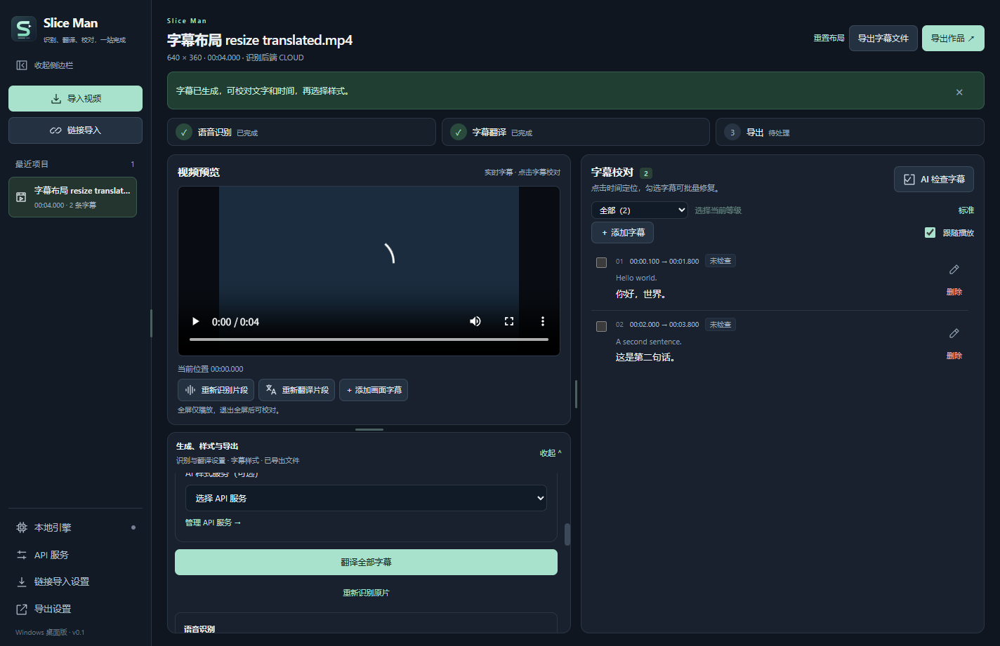

# Slice Man

面向 Windows 的视频字幕工作台：导入、识别、翻译、校对与导出，在一个桌面应用中完成。

支持本地 Whisper、原语言字幕、可选翻译、上下文字幕检查，以及字幕文件或烧录视频导出。界面为中文。



## 下载与安装

在 [Releases](https://github.com/linglan111/slice-man/releases/latest) 下载 Windows x64 安装包 `Slice-Man-Setup-0.1.4.exe`。首次使用本地识别时，在应用内安装 Whisper 引擎和所需模型；使用链接导入前，在“链接导入设置”安装下载工具。

- 已验证环境：Windows 11 x64。Windows 10 尚需独立设备验证。
- 终端用户无需安装 Node.js、Python 或编译器。
- 本地识别支持 CPU；兼容的 NVIDIA GPU 可加速，不可用时回退到 CPU。
- 在线识别、翻译、AI 检查及 AI 样式使用你自行配置的服务和 API Key，应用不提供共享额度。
- 当前安装包未签名。安装包的 SHA-256 见同一 Release 中的 `SHA256SUMS.txt`。

## 主要功能

| 模块 | 功能 |
| --- | --- |
| 视频导入 | 本地视频、通过托管下载工具导入视频链接；独立设置下载格式、编码、分辨率和保存位置。 |
| 语音识别 | 本地 Whisper Base / Small / Large v3 Turbo，或提供分段时间戳的 OpenAI 兼容服务。 |
| 可选翻译 | 默认按不超过 20 分钟的内容章节翻译，支持 1–3 路并发、保留已完成章节；支持 Chat Completions、Responses、Anthropic Messages 和 Gemini 协议。 |
| 字幕校对 | 修改原文、译文和时间，添加/删除字幕，按播放位置跟随；支持选中字幕或时间范围的局部重新识别/翻译。 |
| 上下文检查 | 30 分钟以内整批检查选中字幕，超过 30 分钟按章节检查；保留已完成章节并可继续剩余部分，按统一标准输出无/低/中/高可疑度。 |
| AI 请求日志 | 流式接收回答并写入本地文件，SQLite 记录阶段、耗时、用量与错误；中断内容保留供排查，不完整 JSON 不会应用。 |
| 章节切分与导出 | AI 生成带时间、标题、摘要的章节，可编辑、选择并分别导出；自定义切分标准支持新增、修改、复制、删除和选择。 |
| 工具断点续传 | 本地识别运行库、模型和链接导入工具下载中断后保留已收内容，手动继续时验证续传，支持查看和清理缓存。 |
| 人名检查 | 找出至少在两条字幕中出现的人名，核对出现位置和推荐原名/译名后批量修改；可撤销最近一次成功修改，保留后续人工编辑并提示冲突。 |
| 自动循环修复 | 点击“字幕自动修复”打开弹窗，选择最低疑虑等级、最大轮数及全部字幕或指定时间范围；每轮复查，支持取消和结果说明。关闭重开保留参数，关闭弹窗不中断修复。 |
| 功能导航 | 首次打开显示操作引导；左下角 `?` 可随时再次查看。 |
| 播放预览 | 实时字幕、暂停定位、双语、点击画面字幕编辑及全屏字幕。 |
| 可调整工作区 | 左侧预览、右侧校对；视频下方集中生成/局部处理/样式/导出/人名操作，打开按内容分组、底部对齐的独立操作卡片。生成与样式设置从左下角打开；拖动分隔线调整宽高，记忆尺寸并支持重置。 |
| 导出 | SRT / ASS / VTT 字幕文件，以及烧录字幕的 MP4 / MKV 视频；支持编码、分辨率、质量及内置/AI 样式。 |

## 快速使用

1. 点击“导入视频”或“链接导入”，选择原语言字幕或启用翻译。
2. 在左下角“生成设置”配置识别方式；本地模式先在“本地引擎”安装运行库及模型，云端模式配置语音服务。
3. 在视频下方点击“生成”，确认执行；如启用翻译，先选择翻译服务。仅生成原语言字幕时不需要翻译服务。
4. 在右侧“字幕校对”修改文字和时间；点击时间定位播放，必要时使用局部修复或 AI 检查。
5. 在左下角“样式设置”选择模板、字体与位置；视频下方“样式”可生成 AI 样式。
6. 在视频下方“导出”选择“独立字幕文件”或“字幕烧录视频”，确认格式并保存。

项目标题和元信息位于视频预览卡片顶部，处理步骤在预览标题行居中显示，窄栏时紧凑排列。视频下方带图标的操作按“生成 → 重新识别 → 重新翻译 → 添加画面字幕 → 人名检查 → 样式 → 章节 → 导出”排列，仅原语言项目不显示重新翻译。生成与样式设置统一从左下角打开，预览下方不再显示重复设置区。

操作面板按内容取高，多余空间留给视频；右侧字幕校对和处理结果可单独调整高度。分隔线也可通过键盘方向键、Shift + 方向键和 Home / End 调整；左下角“重置布局”恢复默认尺寸。字幕列表、编辑表单和设置各自滚动，常用校对操作保持可见。

首次打开时可通过功能导航了解准备服务、导入、校对、检查、循环修复和导出；关闭或完成后记忆，左下角 `?` 可重新查看。收起侧栏后，导航与重置布局仍可通过图标打开。

可疑度筛选支持同时选择多个等级或状态。“全选／取消全选”针对当前筛选结果；“选择时间范围”选中与区间相交且符合筛选的字幕，保留其他已选项。

点击“AI 检查字幕”检查全部或当前选中字幕；没有有效检查服务时，可在弹窗明确选择服务。“未检查”包含尚未检查或结果已失效的字幕。“可疑度标准”随时打开统一规则说明。视频时长不超过 30 分钟时，一次正常请求返回全部目标的完整 JSON，上限为 2000 条目标及 512 KiB 完整输入；超过 30 分钟时按内容章节检查，密集章节会拆成有界工作单元。章节边界保留全局相邻字幕证据。失败或取消保留已完成章节，结果区显示覆盖情况，可继续检查剩余章节。格式、覆盖或证据不合格时最多补一次可见纠正；所选模型容量不足时应减少选择或更换模型。

翻译默认复用有效内容章节；20 分钟以内直接使用单章覆盖，较长视频按内容规划，每章不超过 20 分钟。在“生成设置”选择章节服务和并发数（默认 2，范围 1–3）。整片翻译保留已完成章节；局部重译、识别并翻译和当前自动修复轮次仍须全部成功后才替换目标。实际速度、token 用量和准确率取决于内容、模型和服务限流。

“章节”可生成完整内容计划，或根据“自定义切分章节”的所选标准筛出部分内容。核对时间、标题和摘要，保存修改后勾选章节导出；每章独立命名，重名自动避让已有文件。字幕按边界裁剪并从零计时。失败或取消保留完成文件；源字幕、设置和计划兼容时可继续未完成导出。标准库可新增、编辑、复制或删除，已生成计划保留当时的标准快照。

在处理结果区打开“AI 请求日志”查看响应阶段、耗时、字节和服务返回的 token 用量。文字回答流式写入本地文件，兼容同一次请求的普通 JSON 响应；不支持流式的服务可在 API 配置关闭后手动重试。连接/空闲时限沿用服务超时设置，总生成时限默认 30 分钟，可设置 1–60 分钟。中断不会自动重发请求，已收到的不完整 JSON 不会应用。日志不记录密钥、完整提示词或模型思考文本；默认保留 30 天及最近 1000 条已结束记录，可手动清理。

本地引擎、模型、yt-dlp 和 Deno 下载中断后保留固定版本缓存；重新点击安装或继续下载时校验 Range 响应与最终哈希，不会开机自动下载。缓存可以手动清理。视频链接下载本身仍沿用原流程，不属于工具续传。

在视频下方“人名检查”结合全片字幕上下文分析同一人的不同识别写法，例如不同字幕中的“安娜／安纳”可归为一组；每种写法只出现一次也可按同一人跨至少两条字幕计数。姓名相似但上下文表明是不同人的，分别保留。查看每组实际写法、次数与上下文，编辑推荐原名/译名并选择要应用的条目。建议不会自动写入；取消不改变字幕。中文、日文等连写文本按字面出现核对，需确认是否确为同一人。仅保留最近一次成功批次的撤销，重启后仍可使用；后来手工编辑过的同一原文或译文字段整字段保留并显示冲突，其他未改字段可回退。撤销不会恢复已删除或重新识别的旧字幕，也不提供多级撤销或重做。

在右侧校对区启动自动循环修复，选择“全部字幕”或指定起止时间，设置最低疑虑等级和最大轮数。默认“中及以上、3 轮”，支持 1–20 轮；“中及以上”包含中、高等级。原文/时间问题重新识别，译文问题仅重译；原语言模式不调用翻译。跨越所选时间的字幕及必要的重叠字幕会扩展到完整边界，请查看实际处理范围。每轮修复成功后保存并复查；达到上限仍可能存在疑点，可调整范围再次运行。取消或后续失败保留已完成轮次，当前未完成轮次不部分替换。重启后不会自动继续。

## 数据与检查结果

- 本地识别在电脑上处理音频。云端识别向配置的服务发送音频；翻译、AI 检查和样式生成发送相关字幕文字。
- API Key 由主进程管理，支持本地保护保存或仅在当前会话使用；不要提交个人 Key 或用户数据到仓库。
- AI 检查使用文本和时间，不直接监听原音频；检查本身不修改字幕，自动循环修复需要用户主动启动。“无疑虑”不代表语音识别绝对准确。
- 已忽略问题不作为主动修复目标；内容或上下文变化后会重新评估。重新识别必要的重叠区间仍可能影响含忽略问题的字幕。
- 局部处理仅在成功后替换目标字幕；失败或取消保留已有校对结果。重新识别整片会要求确认替换。
- 视频烧录会重新编码；独立字幕导出使用当前校对后的时间轴。较低分辨率视频不会因预设而放大。
- 当前视频发布操作要求目标目录支持硬链接，通常为本地 NTFS；不支持的卷会报告可恢复错误。

更详细的模式、协议、校对及导出说明见 [English workflow guide](docs/usage.en.md)。

## 从源码运行

使用 Windows x64、Node.js 24.17.x 和 npm 11.x：

```powershell
npm ci
npm run setup:resources
npm run dev
```

`setup:resources` 获取并校验固定版本的 FFmpeg、中文字体和测试音频。运行库、模型、缓存、个人数据和安装包不会作为源码提交。

```powershell
npm run lint
npm run typecheck
npm test
npm run build
npm run setup:whisper-fixtures
npm run setup:download-fixtures
npm run test:e2e
```

GPU 端到端测试需要兼容硬件及 `npm run setup:whisper-fixtures -- --gpu`。实网 AI 和公开视频下载测试单独设有显式启用条件，未启用时会跳过。单元/集成测试使用 Electron 内嵌 Node 以匹配 SQLite 原生 ABI。

```powershell
npm run package
npm run make
npm run test:package
```

`package` 生成 `dist/win-unpacked`，`make` 生成 NSIS 安装包。已有便携版正在运行时，请使用独立输出目录，避免覆盖正在使用的文件。版本、资源来源及原生构建细节见 [开发环境](docs/development-environment.md)，发布步骤见 [发布说明](docs/releasing.md)。

## 验证范围

本次工作区回归（2026-10-14）：77 个测试文件、749 项单元/集成测试通过。原生 Electron 回归覆盖真实 CPU/CUDA 识别、字幕校对、短视频 1027 条字幕整批检查、长视频分章检查与续查、人名修改/撤销、播放与全屏、实际分章导出、工具续传、下载转换、取消保留、三个窗口尺寸的操作面板及重启持久化。安装包附带 `VALIDATION.md` 记录对应提交、最终端到端结果、打包验证和跳过条件。

上述结果不等同于实网服务质量、所有公开视频站点兼容性、干净 Windows 设备安装或 Windows 10 验证。后者见 [人工验收清单](docs/manual-acceptance.md)。

## 开源许可证与第三方组件

Slice Man 项目代码使用 [MIT License](LICENSE)。第三方组件、资源和工具保留各自许可证，MIT 声明不覆盖这些组件。

- FFmpeg / FFprobe：独立 GPLv3 可执行工具；固定构建的许可证、配置、外部库版本及来源保存在 `resources/notices`。
- Noto Sans CJK 字体：SIL Open Font License 1.1。
- whisper.cpp 与 Whisper：保留 MIT 通知；运行库和模型由用户按需安装。
- yt-dlp 与 Deno：按需下载；源码、组合二进制和依赖具有各自许可说明。

完整来源见 [RESOURCE-ORIGINS.md](resources/notices/RESOURCE-ORIGINS.md)。第三方工具的重新分发应遵守其许可证及对应源代码要求。

欢迎通过 [Issues](https://github.com/linglan111/slice-man/issues) 提交可复现问题，或通过 Pull Request 贡献改进。报告中请注明系统、版本、复现步骤，并去除 API Key 和个人视频信息。

## 自动发布

只有 `release` 分支自动生成正式 Release；`main` 和开发分支不会发布。同步升级 `package.json`、`package-lock.json` 的版本后，将审核后的代码合并到 `release`。GitHub Actions 通过检查、端到端回归、Windows 构建和打包验证后，发布对应版本的安装包及 SHA-256 清单；已有版本不会覆盖。详见 [发布流程](docs/releasing.md)。
