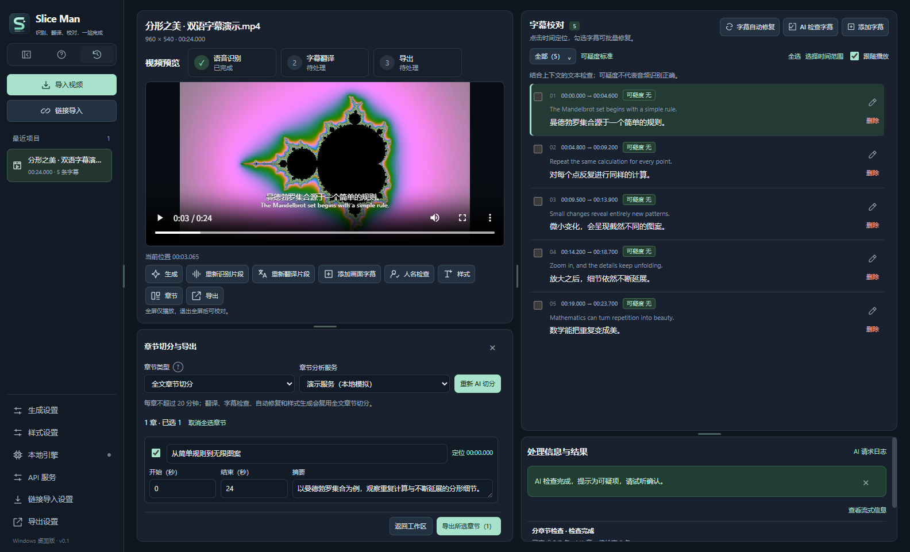

# Slice Man

[English](README.md) | **简体中文**

面向 Windows 的视频字幕工作台：在一个桌面应用中完成视频导入、语音识别、可选翻译、字幕校对、AI 检查与导出。界面为中文，支持只制作原语言字幕。



*v0.1.5 实际界面；视频、字幕与可疑度评级为演示数据，评级由本地模拟服务返回。*

## 下载与安装

在 [最新 Release](https://github.com/linglan111/slice-man/releases/latest) 下载 Windows x64 安装包，版本和 SHA-256 以该 Release 的附件及 `SHA256SUMS.txt` 为准。

- 已验证 Windows 11 x64；Windows 10 仍需独立设备验证。
- 使用安装包无需自行安装 Node.js、Python 或编译器。本地 Whisper 引擎、模型和链接下载工具在应用内按需安装。
- 本地识别支持 CPU；兼容的 NVIDIA GPU 可加速，不可用时回退到 CPU，界面显示实际执行后端。
- 在线识别及 AI 文字功能使用你配置的服务和 API Key，应用不提供共享额度。
- 当前构建未进行代码签名；干净设备安装、升级和 SmartScreen 体验仍需人工验收。

## 主要功能

| 模块 | 支持内容 |
| --- | --- |
| 导入 | 本地视频或视频链接；链接导入可配置下载位置、格式、编码、分辨率和代理。 |
| 语音识别 | 本地 Whisper Base / Small / Large v3 Turbo，或返回分段时间戳的 OpenAI 兼容语音服务；支持整片重新识别和局部重识别。 |
| 可选翻译 | 原语言或翻译字幕项目；支持整片、选中字幕和时间范围翻译，兼容 Chat Completions、Responses、Anthropic Messages、Gemini 文字协议。 |
| 校对与预览 | 编辑原文、译文和时间，添加/删除字幕，播放跟随、定位、画面字幕编辑、双语预览及全屏字幕。 |
| AI 字幕检查 | 全部、已选字幕或时间范围检查；统一无/低/中/高可疑度，显示原因与证据，支持筛选、忽略和待复查状态。 |
| 自动循环修复 | 按范围、最低可疑度和轮数上限执行检查、重新识别、可选翻译、新旧字幕综合审核与复查。 |
| 人名检查 | 全片分析同一人的不同写法，核对实际出现位置与上下文；编辑建议后明确应用，可撤销最近一次成功批次。 |
| 章节 | 复用“全文章节切分”供文字 AI 处理；自定义标准筛选章节，编辑标题、摘要和边界，按章独立导出。 |
| 样式与导出 | 内置/AI 样式；导出 SRT / ASS / VTT，或烧录字幕的 MP4 / MKV，独立设置编码、分辨率和质量。 |
| 处理信息 | 展示阶段、修复轮次、章节/字幕完成数、排队及并发请求；查看流式信息、请求日志并取消处理。 |
| 工作区与工具 | 首次功能导航、可调整分隔线、布局重置；引擎、模型、yt-dlp 和 Deno 的受校验下载续传及缓存清理。 |

## 快速开始

1. **准备服务**：本地识别先在左下角“本地引擎”安装引擎与模型；在线识别、翻译、AI 检查或样式使用的服务在“API 服务”中配置。
2. **导入视频**：选择“导入视频”或“链接导入”，确认源语言和是否启用翻译。原语言项目无需翻译服务，预览、修复和导出都使用原文。
3. **生成字幕**：导入后在左下角“生成设置”选择识别方式及相应服务，再在视频下方点击“生成”并确认。完成后，在右侧“字幕校对”修改文字和时间，点击时间定位播放；局部重新识别/翻译前核对实际范围。
4. **检查与修复**：使用“AI 检查字幕”查看疑点，或主动启动“字幕自动修复”。人名检查单独给出建议，由你确认应用。
5. **设置样式并导出**：左下角“样式设置”配置外观，视频下方“样式”可请求 AI 设计；在“导出”中选择独立字幕或字幕烧录视频。“章节”可导出所选片段。

左上角问号可重开功能导航。各操作打开独立面板，打开面板本身不会开始处理。切换操作时，面板按内容自动取高，自动高度上限为中栏可用高度的 45%，同时为视频保留最小空间；随后可拖动预览与操作区之间的横向分隔线临时调整，下次切换操作重新自动适配。侧栏宽度、左右栏比例和校对/结果区高度会记忆，操作区临时高度不持久保存。“重置布局”恢复默认值，分隔线也支持键盘调整。

## AI 处理方式

### 全文章节与服务并发

翻译、字幕检查、自动修复中的文字阶段、样式生成和自定义章节分析复用有效的“全文章节切分”。每章不超过 20 分钟；没有有效计划的短视频自动建立单章覆盖，较长视频按内容规划。自定义切分用于按标准筛选、导出，不替代处理章节。

每个有目标的章节在每个处理阶段正常生成一次，提供整章时轴、原文、已启用的译文及明确目标。选择部分字幕限制修改或检查目标，仍保留整章上下文。容量不足会明确报错，需调整章节边界或模型；不会静默截断上下文或把密集章节再次拆成隐藏小批次。语音识别按音频区间执行，人名检查一次分析全片字幕，两者不依赖章节。

在 **API 服务设置** 调整“文字请求并发上限”：默认 **2**，范围 **1–16**。使用同一服务配置的文字请求共享上限，包括全片人名分析；语音识别单独处理。整片翻译和字幕检查保留已完成章节，兼容时可继续；局部处理和每轮自动修复须完整成功后才替换目标。实际耗时、token 和效果取决于字幕密度、模型容量及服务限流。

### 检查、循环修复与人名

字幕检查只分析文字和时间，不直接监听原音频，也不自动修改字幕。“无”表示未发现明显疑点，不是准确性保证；“未检查”包含从未检查和需要复查的字幕。修改文字或上下文后，相关旧评级可能失效。可在“可疑度标准”查看统一规则。

自动修复默认“中及以上、3 轮”，支持低/中/高阈值、1–20 轮，以及全部字幕或固定时间范围。每轮先检查缺失/失效评级，对达到阈值的未忽略疑点重新识别，翻译项目再生成新译文；结合整章上下文、新旧时轴/原文/译文和疑点意见综合审核，通过完整校验后一次保存本轮结果，再重新评级。即使审核保留原文，也会重新检查。识别会扩展到完整字幕及必要的重叠区间，请查看实际处理范围；忽略问题并不锁定其所在字幕。

结束前还会补查本次范围和受影响字幕的待复查评级，核对最终保存状态；这一步只检查、不增加修复轮数。达到上限仍可能有疑点，结果会显示剩余数量；取消、失败、中断或最终补查未完成不会宣称全部修好。已保存轮次保留，当前未完成轮次不部分替换，重启后不会自动继续付费处理。关闭修复弹窗不会取消运行，请使用取消按钮。

人名检查保留全片身份上下文，同一人须在至少两条字幕中出现；实际别名、字段、位置和次数经本地核对。查看写法与例句、编辑推荐原名/译名并勾选后才能应用，建议不会自动写入。仅最近一次成功批次可跨重启撤销；后续人工修改保留并提示冲突，不恢复已删除或重识别的字幕。模型格式或证据不合格时，最多进行一次可见的整批纠正；终止失败保留原报告。字面匹配不能证明人物身份，仍需核对上下文。

处理期间可查看每个并发请求的排队、执行和流式状态，同时保留阶段与轮次显示；请求日志记录耗时、字节及服务返回的用量。连接/空闲超时与生成总时限可分别配置，生成总时限默认 30 分钟、可设 1–60 分钟。中断不会自动重发生成请求，不完整 JSON 不会应用。

## 数据、导出与限制

- 本地识别在电脑上处理音频；云端识别会上传音频，翻译、检查、人名、章节和 AI 样式会发送相关字幕文字与时间等上下文。服务的数据处理方式及费用取决于你的服务商。
- API Key 由主进程管理，支持本地保护保存或仅当前会话使用。回答文件保存在本机；日志不保存密钥、完整提示词或模型思考文本，思考仅临时展示。回答可能包含字幕内容，分享诊断前请自行检查。已结束日志默认保留 30 天及最近 1000 条，可手动清理。
- 仅原语言模式不调用翻译，并在预览和全部导出中使用原文；切换模式保留已存译文。整片重新识别需要确认替换已有校对内容，成功后不自动翻译；失败或取消保留原内容，历史导出文件保留。
- 独立字幕使用当前保存的文字和时间，不再调用 AI。视频烧录必定重新编码；选择原编码表示使用受支持的同类编码重新编码，分辨率上限不会放大小尺寸源视频。
- 章节导出按边界裁剪字幕并从零计时，已有文件保留；失败或取消保留完成文件，兼容时可继续未完成导出。视频文件发布要求目标目录支持硬链接，通常为本地 NTFS；不支持时请换目录和新文件名。
- 引擎、模型和下载工具需手动安装/继续，校验成功后才启用；其续传不等同于源视频链接下载续传。链接兼容性受站点、权限和网络条件影响。

详细操作见 [English workflow guide](docs/usage.en.md)，设备安装与实网验证边界见 [人工验收清单](docs/manual-acceptance.md)。测试结果应以对应提交或构建的报告为准，不能推导出所有服务商、GPU、语言或站点均已验证。

## 从源码运行

使用 Windows x64、Node.js **24.17.x** 和 npm **11.x**，安装锁定依赖并准备受校验的 FFmpeg、字体及测试音频：

```powershell
npm ci
npm run setup:resources
npm run dev
```

常用检查和桌面测试：

```powershell
npm run lint
npm run typecheck
npm test
npm run build
npm run setup:whisper-fixtures
npm run setup:download-fixtures
npm run test:e2e
```

单元/集成测试通过 Electron 内嵌 Node 运行，以匹配 SQLite 原生 ABI；不要在桌面测试前为普通 Node 重建 SQLite。GPU 测试另需兼容硬件及 `npm run setup:whisper-fixtures -- --gpu`。付费实网和外部下载测试有显式启用条件，未启用的跳过项不算通过。

```powershell
npm run package
npm run make
npm run test:package
```

`package` 生成 `dist/win-unpacked`，`make` 生成 Windows x64 NSIS 安装包。若该目录的应用正在运行，使用独立输出目录打包，并将对应目录传给 `test:package -- --app-dir <dist下的目录>`。下载的二进制资源、运行库、模型、缓存、个人数据及安装包不作为源码提交。详细环境、原生测试和打包参数见 [开发环境](docs/development-environment.md)。

## 发布与贡献

只有 `release` 分支会自动发布正式 Release，`main` 和其他开发分支不会发布。同步升级 `package.json`、`package-lock.json` 版本后，将审核通过的代码合并至 `release`；GitHub Actions 执行检查、Electron 回归、Windows 构建及打包验证，通过后发布安装包和 SHA-256 清单，已发布版本不覆盖。手动触发也须选择 `release`，具体步骤见 [发布流程](docs/releasing.md)。

欢迎通过 [Issues](https://github.com/linglan111/slice-man/issues) 或 Pull Request 提交问题和改进。请注明系统、应用版本、复现步骤，并移除 API Key 和私人视频/字幕信息。

## 许可证与第三方组件

项目代码使用 [MIT License](LICENSE)。第三方组件保留各自许可证：FFmpeg / FFprobe 为独立 GPLv3 工具，Noto Sans CJK 字体使用 OFL 1.1，Whisper / whisper.cpp 保留 MIT 通知；按需下载的 yt-dlp、Deno 及其依赖遵循各自许可。

组件构建信息、许可通知及对应源代码来源见 [RESOURCE-ORIGINS.md](resources/notices/RESOURCE-ORIGINS.md)。项目的 MIT 许可不替代第三方组件的分发要求。
